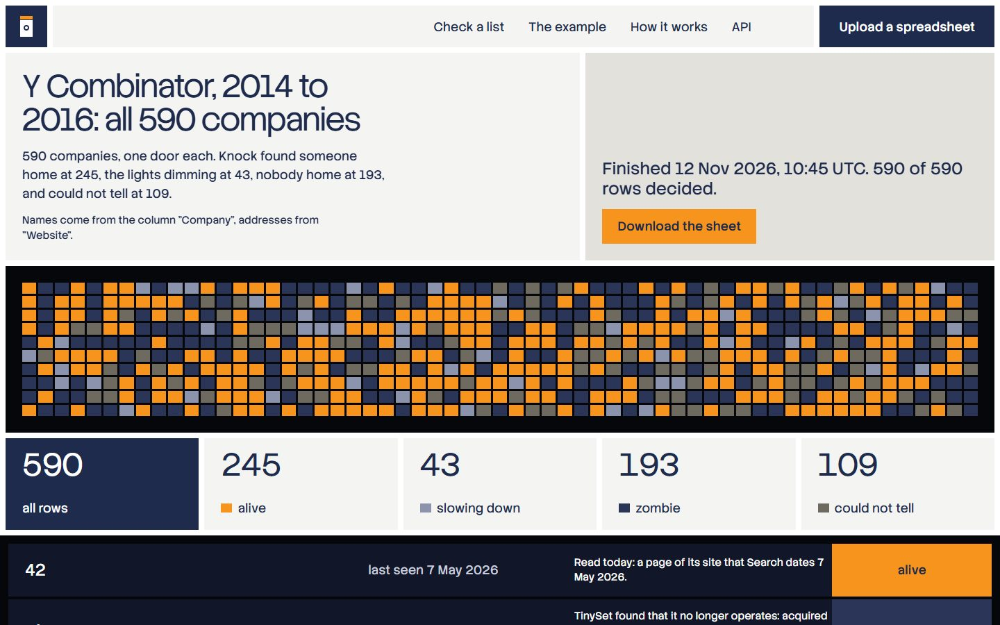

# Knock

**Is anybody home?** Hand in a spreadsheet of companies. Knock goes to every address, reads what is there today, and hands the same sheet back with a verdict on every row: alive, slowing down, zombie, or could not tell. Each row carries the day the company was last seen doing something, where that date comes from, one sentence that says why, and links to the pages the verdict rests on.



Live: **https://knock.hamdanesmail12-7a9.workers.dev**

Built for the TinyFish Student Bounty Drop 002 ("Zombie Check"). TinyFish does all the reading: Fetch reads every address and page, Search lists the dated pages of a company's own site, and TinySet asks the wider web about the rows whose own site cannot say.

## The example: 590 companies

[The example list](https://knock.hamdanesmail12-7a9.workers.dev/example) is every company of Y Combinator's six batches from winter 2014 to summer 2016, as its public directory lists them: 590 rows, names and addresses only. Knock checked it on 12 November 2026.

- All 590 rows had a verdict after 2 hours 57 minutes, on Cloudflare's free plan: 86 Workflow runs, 1,329 calls to TinyFish, no step tried twice, no run failed.
- Reading and searching cost nothing. 200 of the rows then went to TinySet in five sets, for $7.30 in all.
- The list now: 245 alive, 43 slowing down, 193 zombie, 109 could not tell. 95 of the zombies rest on a shutdown or a purchase that TinySet found and whose source Knock read.

Y Combinator's directory says of each of these companies whether it is active, was acquired or is inactive. Knock never reads that record, and a source on Y Combinator's own site decides nothing. I set the two side by side afterwards:

| The record says | Alive | Slowing down | Zombie | Could not tell |
|---|---|---|---|---|
| Running (244) | 188 | 21 | 10 | 25 |
| Bought (162) | 47 | 16 | 79 | 20 |
| Gone (184) | 10 | 6 | 104 | 64 |

How I read it:

- Of the 244 companies the record calls running, Knock calls 209 alive or slowing down and 10 zombie. Four of those ten have a shutdown or a merger with a source that Knock read, so there the record may be the one that is out of date.
- Of the 184 the record calls gone, Knock calls 104 zombie and cannot tell for 64. It calls 16 alive or slowing down: a dead company whose site still loads and still shows a recent date looks alive from outside.
- "Bought" is neither. A bought company may run on under its own address, or be closed.
- **I changed three rules after seeing this comparison.** So this is a score on the list the rules were tuned on, and not an independent test. With the free signs alone, before TinySet and before any tuning, the same table read 185, 18, 17, 24 for the running, 47, 17, 60, 38 for the bought and 9, 6, 73, 96 for the gone. [The plan](docs/plan.md) has every step in between, and what each set cost.

## Try it

**One address.** On the [first page](https://knock.hamdanesmail12-7a9.workers.dev), type a company's address under "Knock on one door". The page that comes back shows the verdict and every sign behind it.

**A spreadsheet.** A CSV file, the link of a Google Sheet (shared so that anyone with the link can view it), or pasted text, up to 1,000 rows. Knock finds the column with the names and the column with the addresses by itself, and the list's page says which it took.

- The list's page shows a wall with one door for every row. The doors take their light as the rows are decided, 40 rows at a time, and the page updates by itself.
- A long list takes hours, not minutes: Knock asks Search at most seven times a minute. The 590 took just under three hours. You can close the page; the list's address is all you need to come back.
- "Download the sheet" gives your own columns back, untouched and in their order, with thirteen of Knock's after them. It works while the list is still being checked.

## The six signs

| The sign | What Knock does |
|---|---|
| The door | Reads the company's address with TinyFish Fetch. It answers, forwards to another site (which names the company or does not), is for sale, is nearly empty, no longer exists, answers with an error, does not answer in time, or blocks readers. A door that failed is knocked on a second time. |
| New pages | Asks TinyFish Search for dated pages on the company's own site: first in the last 12 months, then 12 to 36 months ago, then older. |
| The page's own date | Reads the newest page Search listed. When that page states its own date, that date is used and not the index's. |
| A jobs page | Follows the link from the home page and reads it. |
| A sign-up page | Follows the link from the home page and reads it. |
| What others say | Asks TinySet, for the rows whose own site cannot say: whether the company still operates, what happened to it and when, with a source, and its latest public activity with a link. |

Nothing is taken from memory. A verdict rests only on pages Knock read that day.

## The nine rules

The first rule that fits decides, so the same signs always give the same verdict.

1. TinySet found that the company no longer operates, and Knock read the source: **zombie**.
2. The address is for sale: **zombie**.
3. The address no longer exists, and nothing says the company operates under another: **zombie**.
4. The address forwards to a site that does not name the company, and nothing says it still operates: **zombie**.
5. A dated sign from the last 12 months: **alive**.
6. The newest dated sign is 12 to 36 months old; or nothing is dated, but the door answers and a jobs or sign-up page is there; or a source read today says it operates: **slowing down**.
7. The newest dated sign is more than 36 months old: **zombie**.
8. The home page is nearly empty and nothing else was found: **zombie**.
9. Anything else: **could not tell**, with the reason.

Rules 3, 4, 7 and 8 rest on what the company's own address shows. When TinySet says the company still operates but gave no source Knock could read and that names it, Knock does not call the company a zombie on those signs alone: the row says could not tell, and gives both facts.

## The sheet that comes back

| Column | What it holds |
|---|---|
| `knock_verdict` | alive, slowing down, zombie, or could not tell |
| `knock_last_seen` | The day of the newest dated sign. |
| `knock_last_seen_from` | Where that date comes from: the page's own date, the date from search, the server's date for the home page, or TinySet's source. |
| `knock_why` | One sentence: what decided, and what it rests on. |
| `knock_door`, `knock_new_pages`, `knock_jobs_page`, `knock_signup_page`, `knock_outside` | Each sign in words, so the signs behind a verdict can be read in the sheet itself. |
| `knock_evidence_1` to `knock_evidence_3` | Links to the pages the verdict rests on, the deciding one first. |
| `knock_checked_on` | The day the row was checked. |

## Where TinyFish does the work

| TinyFish API | What Knock uses it for |
|---|---|
| Fetch | Every address and every page: the home page, the newest page Search listed, the jobs page, the sign-up page, and every source link TinySet gives. Five addresses in one call. |
| Search | The dated pages of one company's site, window by window. Its dates are what "last seen" most often rests on. |
| TinySet | The rows a company's own site cannot decide: a site that is gone, for sale, silent, or that turns readers away. Fifty rows to a set. |
| The wallet | Read before a set and ten minutes after it. A set is booked at what the wallet lost. |

TinySet is built to find its own rows, so I had to make it keep to mine. The list is written into the dataset's description, and the company's name is the set's key. What comes back is still not trusted:

- A row under a name that is not on the list, or on another website than the one sent, is thrown away.
- Every source link is read by Knock itself, and counts only when the page could be read and names the company.
- A renamed company's new site does not carry its old name. A new page there counts once a source that names the old name was read, and not before, because an address that someone else took over would look the same.
- A cell that holds two names, as "Kenota (formerly ExVivo Labs)", is matched by the name outside the brackets. The name inside them counts only when the site that was sent comes back with it.
- A set's fill is asked for once, in a step that is never tried a second time.

## What it cannot tell

- A running company whose site carries no date anywhere comes out as slowing down.
- A date from the search index is the day a page was first published. A page that is kept up to date can look older than it is.
- A verdict that rests on one search can change from one day to the next, because the index does.
- An address that someone else has taken over and filled with new pages can look alive. TinySet's part is what catches it.
- A company whose name is an everyday word, as Shape or Final, is named by any page that uses the word.

## API

| Route | What it does |
|---|---|
| `POST /api/lists?title=...` | Hand in a sheet as `text/csv`. Or send JSON: `{"csv": "...", "title": "..."}` or `{"sheet_url": "https://docs.google.com/spreadsheets/d/..."}`, with `name_col`, `address_col` and `first_line_is_header` if Knock should not find them itself. Answers `202` with `id`, `url`, `api`, `csv` and `rows`. |
| `GET /api/lists/:id` | Where the list stands: status, rows decided, counts by verdict, and the wall as one string. |
| `GET /api/lists/:id/rows?from=0&count=200&verdict=zombie` | The rows with their signs, up to 200 at a time. `next` is where the following page begins. |
| `GET /api/lists/:id/csv` | The sheet, with Knock's columns. |
| `POST /api/lists/:id/carry-on` | Start a list again where it stopped. It refuses while the list is still moving. |
| `POST /api/knock` | One address: `{"address": "stripe.com"}`. Answers with the row. |
| `GET /api/stats` | Lists, rows decided, counts by verdict, spend. |

Refusals are plain: `400 empty_sheet`, `400 header_only`, `400 bad_column`, `400 bad_sheet_link`, `400 sheet_not_shared`, `400 too_many_rows`, `413 sheet_too_large`, `429 daily_limit`, `429 too_many_knocks`, each with a `message`. The same routes are at the foot of [How it works](https://knock.hamdanesmail12-7a9.workers.dev/how#api).

## Limits and cost

- A sheet may hold 1,000 rows. Visitors together may hand in three lists a day. One visitor gets ten single doors an hour.
- Reading pages and searching cost nothing so far. Knock keeps to 800 pages a day and seven searches a minute, and a list that has used the day's pages waits for midnight UTC and carries on by itself.
- TinySet costs money, so only I can start a set. TinyFish's rate card says $0.10 a row; what the wallet lost was three to six cents a row, and nothing for a set whose rows had no website.
- One setting caps what Knock may ever spend. The spend so far is at the foot of every page.
- Everything runs on Cloudflare's free plan, which allows one Workflow run 50 requests to other hosts and 50 database queries. A list is therefore carried by many short runs that hand over to one another. The 590 took 86.

## Run it yourself

Node 24 or newer, and a TinyFish API key.

```bash
npm install
cp .dev.vars.example .dev.vars   # then put your key in it
npm run migrate:local
npm run dev
```

```bash
npm run check       # type check, 253 tests, and a dry-run deploy
```

The tests never touch the network: TinyFish and Google are replaced by stand-ins that fail on any call they were not told about. To deploy, and to put rows to TinySet, see [docs/runbook.md](docs/runbook.md).

## Where things are

| Path | What is there |
|---|---|
| `src/core/` | The parts with no network and no database: reading a sheet, finding the columns, addresses, names and dates, what a door answered, the dated pages, the nine rules, the thirteen columns, and every limit in one file. |
| `src/tinyfish/` | The TinyFish calls: Fetch, Search, the wallet, and the datasets behind TinySet. |
| `src/list/` | A list from the sheet to the last verdict, as the legs a Workflow runs; "Carry on"; a Google Sheet's link; deciding a finished list again. |
| `src/outside/` | TinySet: what a set asks for, which rows go, matching what comes back, and the books. |
| `src/one/` | "Knock on one door". |
| `src/site/`, `src/app.tsx` | The pages and every route. |
| `docs/` | The [design](docs/specs/2026-11-11-knock-design.md), the [build plan](docs/plan.md) with what every live run showed, the [build log](docs/build-log.md) and the [runbook](docs/runbook.md). |

Stack: TypeScript, Hono, Cloudflare Workers with D1 and Workflows, all on the free plan.

Built by [Hamdan Esmail](https://github.com/HamdanEsmail). MIT licence.
